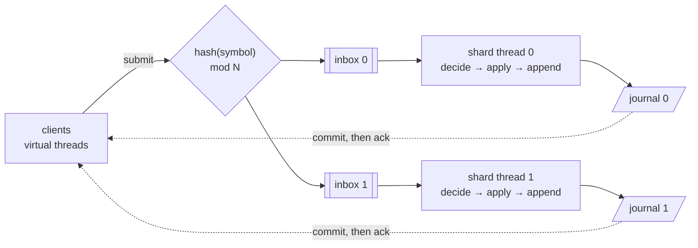

# matching-engine

[](https://github.com/leonglotsky/matching-engine/actions/workflows/ci.yml)


A deterministic, event-sourced **limit order book matching engine** in plain Java 21.

* **Price-time priority** order book with limit (GTC / IOC / FOK), market and cancel orders.
* **Single-writer shards**: symbols are partitioned across threads; no locks on the matching path.
* **Deterministic**: the same sequence of inputs always yields the same trades, proven under
  32 concurrent virtual-thread clients.
* **Event-sourced**: an append-only, CRC-checked journal is the source of truth; restart = replay.
* **Durable acks**: group commit, and a client is only acknowledged after its events are journaled.
* **Idempotent**: resending an order with the same client id never double-fills, even across restarts.
* **Fail-stop**: disk errors or bugs halt one shard cleanly instead of serving a state that cannot be
  recovered.

No Kafka, no database, no framework: `engine-core` has zero runtime dependencies.

## Quick start

Requires JDK 21 and Maven 3.9+.

```bash
mvn verify                                   # build + 53 tests
java -jar engine-core/target/engine-core-0.1.0-SNAPSHOT.jar          # end-to-end demo
java -jar engine-core/target/engine-core-0.1.0-SNAPSHOT.jar --fsync  # same, fsync on every commit
java -jar engine-benchmarks/target/benchmarks.jar                    # JMH (about 10 minutes)
```

The demo starts 64 virtual-thread clients trading 16 symbols on 4 shards against a file journal,
reports throughput and latency, then restarts the engine from the journal and verifies every book:

```
Matching engine demo: 64 clients x 20,000 orders, 16 symbols on 4 shards, journal=./journal (OS_CACHE)

Processed 1,280,000 commands in 4.52 s -> 283,485 commands/s, 630,876 trades
Round-trip latency (submit -> journaled ack), closed loop: p50 132.5 us  p99 1326.7 us  p99.9 6645.9 us  max 86796.9 us

Recovered 2,657,402 events (196.7 MB) in 2.91 s -> 914,151 events/s
Replay check: 16/16 books identical to pre-restart state -> OK
```

## Using it

```java
try (var engine = MatchingEngine.builder()
        .symbols("AAPL", "MSFT")
        .shards(4)
        .journals(FileJournal.directory(Path.of("journal"), 4, SyncPolicy.FSYNC))
        .start()) {                                       // replays the journal before accepting work

    engine.submit(LimitOrder.gtc("AAPL", "alice", "a-1", Side.SELL, 19_050, 100));
    CommandResult result = engine.submit(new MarketOrder("AAPL", "bob", "b-1", Side.BUY, 40)).join();

    switch (result) {                                     // sealed: the compiler checks every case
        case CommandResult.Processed(var events) -> events.forEach(System.out::println);
        case CommandResult.Duplicate(var orderId) -> log.info("already accepted as {}", orderId);
        case CommandResult.Overloaded o -> backOffAndRetry();
        case CommandResult.Unavailable u -> reconnectLater(u.reason());
        case CommandResult.UnknownSymbol u -> reject(u.symbol());
    }
}
```

```
OrderAccepted[sequence=3, symbol=AAPL, orderId=2, accountId=bob, clientOrderId=b-1, side=BUY, orderType=MARKET, ...]
TradeExecuted[sequence=4, symbol=AAPL, tradeId=1, price=19050, quantity=40, makerOrderId=1, takerOrderId=2, takerSide=BUY]
```

## How it works



1. `submit` routes the command to the shard that owns its symbol and returns a `CompletableFuture`.
2. The shard thread drains a batch from its bounded queue. For each command, the order book's pure
   `decide` computes the events, `apply` mutates the book from those events, and the events are
   appended to the journal.
3. One `commit` (optionally `fsync`) covers the whole batch, then all futures in it complete.
4. On restart, each shard folds its journal through the same `apply`, so the recovered books are
   identical to the ones clients were acknowledged against.

The full picture is in [docs/architecture.md](docs/architecture.md).

## Benchmark results

Measured with JMH on a 4 vCPU Intel Xeon @ 2.10 GHz cloud VM (shared, so treat as indicative),
JDK 21, `-Xmx2g`. Full tables and methodology: [docs/performance.md](docs/performance.md).

**Matching core**, single thread, `OrderBook.process` directly:

| Workload | Throughput | p50 | p99 |
|---|---|---|---|
| Passive place + cancel (20×5-deep book) | 3.6 M ops/s | 0.12 µs | 0.66 µs |
| Rest + aggressive fill | 1.7 M ops/s | 0.23 µs | 1.2 µs |
| Realistic mix (limits, IOC/FOK, market, cancels) | 1.2 M ops/s | 0.46 µs | 3.3 µs |

**End to end** through `submit().join()`, 8 closed-loop clients, 4 shards:

| Journal | Throughput | p50 | p99 |
|---|---|---|---|
| None | 131 k cmd/s | 50 µs | 187 µs |
| File, page cache | 116 k cmd/s | 56 µs | 214 µs |
| File, `fsync` every commit | 16 k cmd/s | 495 µs | 1.5 ms |

The matching core is ~10x faster than the round trip: thread hand-off, not matching, is the cost, and
group commit is what makes `fsync` usable. Analysis and optimisation roadmap in
[performance.md](docs/performance.md).

## Documentation

| Document | What it covers |
|---|---|
| [architecture.md](docs/architecture.md) | Components, threading model, order book layout, journal format, command lifecycle |
| [design-decisions.md](docs/design-decisions.md) | Summary of every decision, linking to the [ADRs](docs/adr/) with alternatives considered |
| [scalability.md](docs/scalability.md) | Limits, scaling up, snapshots, scaling out with replicated state machines |
| [failure-scenarios.md](docs/failure-scenarios.md) | Crash, power loss, torn writes, corruption, disk full, overload, duplicates: what happens and why |
| [performance.md](docs/performance.md) | Benchmark methodology, results, analysis and optimisation roadmap |

## Tests worth reading

| Test | Proves |
|---|---|
| `DeterminismTest` | 32 virtual-thread clients race on 8 symbols / 4 shards. Re-running each symbol's captured input tape single-threaded reproduces identical events and books, and an engine rebuilt from the journal has identical books. Quantity is conserved for every order. |
| `MatchingEngineTest.Recovery` | Restart from file journal restores books, idempotency keys, sequence numbers and cancellability. |
| `MatchingEngineTest.Failures` | A failing journal halts only its shard, nothing undurable is acked, other shards keep trading. |
| `FileJournalTest.tornTailIsTruncatedAtEveryPossibleCutPoint` | Cuts a real journal at every byte offset; recovery always yields a clean prefix. |
| `OrderBookTest` | Price-time priority, partial fills, IOC/FOK/market semantics, cancels, validation, idempotency. |

## Project layout

```
engine-core/         plain-Java engine (no runtime dependencies)
  domain/            sealed Command and EngineEvent hierarchies (records)
  book/              OrderBook (decide/apply), PriceLevel, BookSnapshot
  engine/            MatchingEngine, Shard, CommandResult
  journal/           Journal, FileJournal, EventCodec
  sim/               WorkloadGenerator (seeded order flow)
  demo/              DemoMain
engine-benchmarks/   JMH benchmarks
docs/                architecture, ADRs, scalability, failures, performance
```

## Roadmap

Snapshots for O(1) restart, a thin REST/WebSocket gateway module, self-trade prevention, an array-based
price ladder, and journal replication for hot standby. Designs for each are in
[scalability.md](docs/scalability.md).
