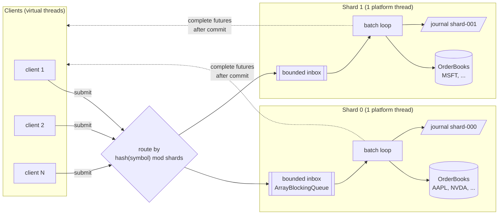
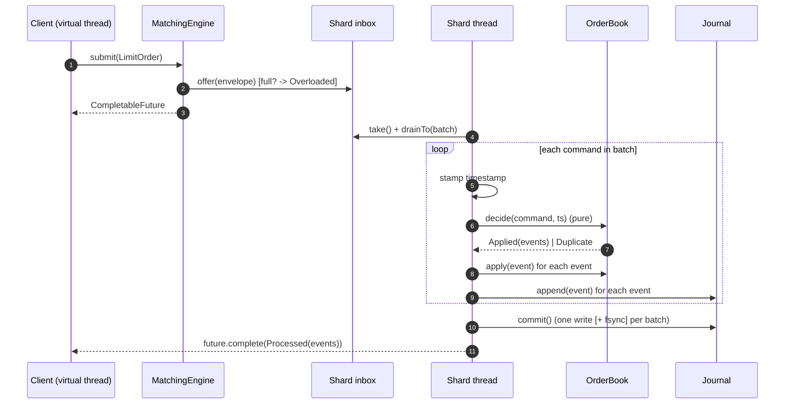

# Architecture

## One-paragraph summary

Clients call `MatchingEngine.submit(command)` from any thread (typically one virtual thread per
connection). The engine routes the command by symbol to exactly one **shard**. A shard is a bounded
queue, a set of order books, a journal file and **one platform thread that owns all of them**. That
thread drains commands in batches, runs each through the order book (`decide` then `apply`), appends
the resulting events to the journal, commits the journal once per batch, and only then completes the
callers' futures. On restart, each shard folds its journal back through the same `apply` method, which
rebuilds the books exactly.

## Component view



## Code map

| Package | What lives there | Key types |
|---|---|---|
| `domain` | Inputs and facts. No logic. | `Command` (sealed: `LimitOrder`, `MarketOrder`, `CancelOrder`), `EngineEvent` (sealed: `OrderAccepted`, `TradeExecuted`, `OrderRested`, `OrderCancelled`, `OrderRejected`, `CancelRejected`) |
| `book` | Single-symbol matching. Pure, single-threaded. | `OrderBook` (`decide`, `apply`, `process`), `PriceLevel`, `BookSnapshot` |
| `engine` | Concurrency, routing, lifecycle. | `MatchingEngine`, `Shard`, `CommandResult` (sealed) |
| `journal` | Durability and recovery. | `Journal`, `FileJournal`, `EventCodec`, `InMemoryJournal` |
| `sim` | Reproducible order flow for tests, demo and benchmarks. | `WorkloadGenerator` |
| `demo` | Runnable end-to-end demo. | `DemoMain` |

`engine-core` has **zero runtime dependencies**. JUnit/AssertJ are test-only and JMH lives in its own
module (`engine-benchmarks`).

## Lifecycle of a command



Steps 6-9 never touch another thread's data, so there are no locks on the matching path. The only
synchronisation is the queue hand-off (steps 2 and 4) and the future completion (step 11).

## The order book

```
bids: TreeMap<Long, PriceLevel> (descending)      asks: TreeMap<Long, PriceLevel> (ascending)
  10002 -> [o17:30] [o21:5]                         10003 -> [o12:100] [o40:7]
   9999 -> [o3:100]                                 10010 -> [o8:50]
          ^ FIFO by arrival (LinkedHashMap)
live: HashMap<orderId, RestingOrder>          acceptedKeys: HashMap<(account, clientOrderId), orderId>
```

* **Price priority**: the `TreeMap` iterates best price first.
* **Time priority**: each `PriceLevel` is a `LinkedHashMap` used as a Java 21 `SequencedMap`: FIFO
  iteration plus O(1) removal by order id.
* **Cancel**: `acceptedKeys` → order id → `live` → level, all O(1) except the `TreeMap` removal of an
  emptied level (O(log L), L = number of levels).
* **Trades execute at the maker's price.** The taker gets any price improvement.

### decide / apply (the event-sourced "decider")

```java
Outcome decide(Command c, long ts);  // pure: reads the book, returns events, mutates nothing
void    apply(EngineEvent e);        // the ONLY mutation path; validates the event against state
```

Live processing is `decide` followed by `apply` on each event. Recovery is `apply` on each journaled
event. Because both go through the same `apply`, a recovered book cannot diverge from the original.
`apply` also checks invariants (gap-free sequence, contiguous order and trade ids, maker exists, no
overfill), so a damaged or mismatched journal fails loudly instead of producing a plausible-looking
wrong book. See [ADR-0002](adr/0002-event-sourcing-with-decide-apply.md).

## Determinism

Given the same sequence of `(command, timestamp)` pairs, a book produces the same events. Nothing in
`decide` or `apply` reads the clock, a random source, a hash-ordered collection, or another thread.
Timestamps are stamped by the shard **once**, written into `OrderAccepted`, and never re-read on replay.

Concurrency only affects the order in which commands reach a shard. `DeterminismTest` proves the rest:
32 virtual-thread clients race on 8 symbols across 4 shards; afterwards, (1) replaying the captured
per-symbol input tape single-threaded yields byte-identical events and books, and (2) a new engine
rebuilt from the journal has identical books.

## Journal format

```
file   := magic "MEJN" | version:int32 | record*
record := length:int32 | crc32c:int32 | payload
payload:= tag:int8 | sequence:int64 | symbol:utf | fields...   (EventCodec)
```

One file per shard, plus `journal.properties` pinning the shard count. See
[failure-scenarios.md](failure-scenarios.md) for torn writes and corruption handling.

## What is deliberately out of scope

* Network API (REST/WebSocket/FIX). The core is a library; a gateway is a thin layer on `submit`.
* Replication / hot standby. Designed for it (deterministic replay of a log), not implemented. See
  [scalability.md](scalability.md).
* Snapshots for fast restart, self-trade prevention, risk checks, market data fan-out. Listed with
  designs in [scalability.md](scalability.md).
