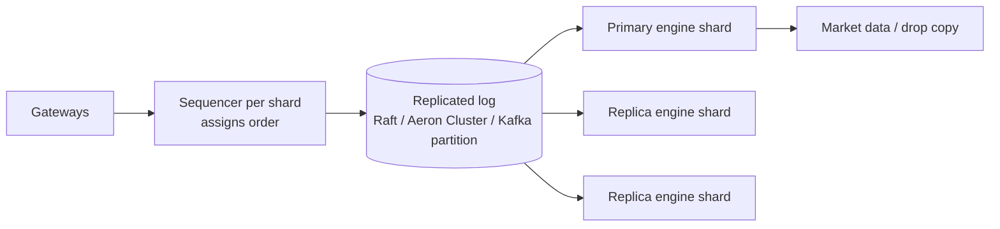

# Scalability

## Where the limits are

| Dimension | Scales with | Limit |
|---|---|---|
| Number of symbols | Shards (cores) | Near-linear until cores or journal bandwidth run out. Books are independent. |
| Throughput of one symbol | Single-thread speed | One core. A book is inherently sequential (price-time priority is a total order). |
| Number of clients | Virtual threads | Very high. A blocked client costs a few KB of heap, not an OS thread. |
| Book depth | `TreeMap` | O(log L) in number of *levels*, O(1) in orders per level. |
| Journal size | Disk | Restart time grows linearly with journal length (snapshots fix this). |

Measured numbers are in [performance.md](performance.md).

## Scaling up on one machine

1. **More shards, up to physical cores** (leave cores for the gateway and the OS). Hot symbols can be
   given a dedicated shard by replacing hash routing with an explicit symbol → shard map.
2. **Pin shard threads** to isolated cores (`taskset`/`isolcpus`) to remove scheduler jitter.
3. **Faster hand-off**: replace `ArrayBlockingQueue` with a single-consumer ring buffer (Disruptor or
   JCTools MPSC). The `Shard` inbox is the only place that changes.
4. **Allocation-free book**: array price ladder, intrusive order lists, object pools, primitive maps.
   See ADR-0004.
5. **Journal**: one file per shard already avoids contention. Next: preallocated, memory-mapped
   segments, and a separate journaling stage so matching of batch *n+1* overlaps with `fsync` of batch *n*.

## Faster restarts: snapshots

Replaying the whole journal is O(history). Fix:

1. Periodically, on the shard thread between batches, serialise `BookSnapshot` plus `lastSequence`,
   `lastOrderId`, `lastTradeId` and the idempotency keys.
2. Write it beside the journal with the journal offset it corresponds to.
3. Restart = load latest valid snapshot + replay only the journal suffix.
4. Old journal segments before the oldest kept snapshot can be archived.

Determinism gives a free correctness check: a snapshot must equal the state obtained by full replay
(the same comparison `DeterminismTest` already makes).

## Scaling out across machines

Because each shard is a deterministic state machine fed by an ordered log, the standard
replicated-state-machine designs apply directly:

* **Partitioning**: shards become processes; each owns a symbol range. Routing tables live in the
  gateway. Moving a symbol = snapshot, stop accepting for that symbol, transfer, resume on the new owner.
* **High availability**: replicate the sequenced input (or the event log) to replicas that run the same
  code. On primary failure, a replica that has applied the same prefix has *identical* books and takes
  over. This is how LMAX, Aeron Cluster and most exchange matching engines work.
* **Kafka**: a natural transport for the event stream to downstream consumers (risk, clearing,
  market data, analytics) with one partition per shard to keep order. Using it *as* the journal on the
  critical path trades latency (broker round trip, `acks=all`) for operational simplicity.
* **Database**: belongs downstream. A consumer projects events into MySQL for queries and reporting; the
  engine never waits on it.

## What does not scale, by design

* A single symbol beyond one core. Mitigations used by real venues: faster code, not more threads.
* Cross-symbol atomic operations (e.g. multi-leg orders spanning shards) would need a coordinator; out
  of scope.
